# Documento de diseño – Choki Rush: La Ruta del Profe

## 1. Descripción

Juego de carreras arcade con vista cenital. El jugador elige uno de cuatro pilotos y recorre
cuatro niveles (Avenida Central, Costa Dorada, Paso Nevado y Ciudad Neón) esquivando tráfico,
recogiendo las **caras del profe** (monedas de puntos) y administrando la gasolina.

## 2. Reglas

- Se mantiene **acelerar** para avanzar; se gira con izquierda/derecha.
- La **gasolina** baja con el tiempo (más rápido a mayor velocidad). Si llega a 0, el auto se detiene y la partida termina.
- **Chocar** con un auto o **salirse de la pista** cuesta 8 de gasolina y unos segundos; luego el auto reaparece parpadeando (invulnerable 2 s).
- **Meta**: al llegar al final del nivel, la gasolina sobrante se convierte en puntos (20 por unidad) y se pasa al siguiente nivel con el tanque lleno.
- **Victoria**: completar los 4 niveles. **Derrota**: quedarse sin gasolina.
- Puntos: 10 por cada 100 m, 50 por auto adelantado, 500 por cara del profe (combo ×2, ×3, ×4 si recoges varias seguidas en menos de 3 s), 150 por destruir un auto con escudo, bono de gasolina en la meta.

### Objetos y enemigos

| Elemento | Efecto |
|---|---|
| Cara del profe | +500 pts con combo |
| Bidón de gasolina | +20 de gasolina |
| Escudo | 6 s invencible; los autos que tocas explotan |
| Mancha (aceite / hielo) | Te hace derrapar |
| Auto civil | Va recto por su carril |
| Auto rosa (zigzag) | Oscila de lado a lado |
| Camión | Lento y grande |
| Auto azul (rival) | IA: si te acercas por detrás se mueve hacia tu carril |

## 3. Diagrama de clases (UML)

```mermaid
classDiagram
    direction TB

    class Juego {
        +pantalla
        +recursos: Recursos
        +audio: GestorAudio
        +records: GestorRecords
        -_escena: Escena
        +cambiar_escena(escena)
        +ejecutar()
        +salir()
    }

    class Escena {
        <<abstract>>
        +juego: Juego
        +al_entrar()
        +manejar_evento(ev)*
        +actualizar(dt)*
        +dibujar(sup)*
    }
    Escena <|-- MenuPrincipal
    Escena <|-- SeleccionPiloto
    Escena <|-- ComoJugar
    Escena <|-- TablaRecords
    Escena <|-- Carrera
    Escena <|-- FinPartida

    class Carrera {
        -_jugador: Jugador
        -_pista: Pista
        -_marcador: Marcador
        -_enemigos: list~Enemigo~
        -_objetos: list~Interactivo~
        -_efectos: list~Efecto~
        -_estado
        +pista / jugador / marcador / controles / camara
        +sonido(nombre)
        +texto_flotante(x, y, txt, color)
        -_generar()
        -_colisiones()
    }

    class Entidad {
        <<abstract>>
        -_x
        -_y
        -_sprite
        -_activo
        +hitbox() Rect
        +actualizar(dt, mundo)*
        +dibujar(sup, camara)
        +desactivar()
    }
    class Vehiculo {
        -_velocidad
        #_avanzar(dt)
    }
    class Jugador {
        -_personaje: Personaje
        -_gasolina
        -_estado
        -_t_escudo
        +recargar(cant)
        +gastar(cant)
        +chocar() bool
        +derrapar() bool
        +activar_escudo(seg)
    }
    class Enemigo {
        <<abstract>>
        -_desp
        +crear(desp, y, recursos, rng)*$
        #_comportamiento(dt, mundo)*
    }
    Entidad <|-- Vehiculo
    Vehiculo <|-- Jugador
    Vehiculo <|-- Enemigo
    Enemigo <|-- AutoCivil
    Enemigo <|-- AutoZigzag
    Enemigo <|-- Camion
    Enemigo <|-- AutoRival

    class Interactivo {
        <<abstract>>
        +interactuar(jugador, mundo)*
    }
    class Coleccionable {
        <<abstract>>
        #_aplicar(jugador, mundo)*
    }
    class Obstaculo {
        <<abstract>>
    }
    Entidad <|-- Interactivo
    Interactivo <|-- Coleccionable
    Interactivo <|-- Obstaculo
    Coleccionable <|-- CaraProfe
    Coleccionable <|-- Gasolina
    Coleccionable <|-- Escudo
    Obstaculo <|-- Mancha

    class Efecto {
        <<abstract>>
        +actualizar(dt)
        +dibujar(sup, camara)*
    }
    Efecto <|-- Particula
    Efecto <|-- TextoFlotante

    class Personaje {
        <<dataclass frozen>>
        +nombre
        +velocidad_max
        +aceleracion
        +manejo
        +eficiencia
        +estadisticas()
    }
    class Pista {
        -_nivel: Nivel
        +centro(d)
        +ancho(d)
        +limites(d)
        +dibujar(sup, camara)
    }
    class Nivel {
        <<dataclass frozen>>
        +numero
        +tema: Tema
        +longitud
        +enemigos
    }
    class Marcador {
        -_puntos
        -_combo
        +sumar(cant)
        +recoger_cara(base) int
        +registrar_adelanto(pts)
    }
    class GestorAudio {
        +cargar(avisar)
        +musica(nombre)
        +efecto(nombre)
        +jingle(nombre)
    }
    class Sintetizador {
        +tono(...)
        +ruido(...)
    }
    class GestorRecords {
        +califica(pts) bool
        +agregar(ini, pts, piloto, nivel)
    }
    class Recursos {
        +cara_profe
        +auto(color)
        +retrato(personaje)
    }

    class PersonajePersonalizado {
        <<dataclass frozen>>
        +niveles
        +sprite: SpritePixel
        +crear(nombre, color, niveles, sprite)$
        +cabeza() SpritePixel
        +a_dict() / desde_dict()
    }
    Personaje <|-- PersonajePersonalizado
    class SpritePixel {
        <<dataclass frozen>>
        +ancho
        +alto
        +paleta
        +pixeles
        +a_superficie()
        +a_dict() / desde_dict()
    }
    class Pixelador {
        +procesar(bytes) SpritePixel
        -_quitar_fondo()
        -_kmeans()
    }
    Pixelador ..> SpritePixel
    PersonajePersonalizado --> SpritePixel
    class Dificultad {
        <<dataclass frozen>>
        +factor_trafico
        +factor_consumo
        +costo_choque
        +factor_puntos
    }
    Carrera --> Dificultad
    class Almacen {
        <<abstract>>
        +leer(clave)*
        +escribir(clave, valor)*
    }
    Almacen <|-- AlmacenArchivo
    Almacen <|-- AlmacenNavegador
    class SelectorImagen {
        <<abstract>>
        +abrir()*
        +resultado()*
    }
    SelectorImagen <|-- SelectorEscritorio
    SelectorImagen <|-- SelectorNavegador
    class ClienteRed {
        <<abstract>>
        +enviar(metodo, ruta, datos)* Peticion
    }
    ClienteRed <|-- ClienteNavegador
    ClienteRed <|-- ClienteEscritorio
    ClienteRed <|-- ClienteDesconectado
    class ServicioPuntajes {
        +enviar(entrada) Peticion
        +top(limite, dificultad) Peticion
    }
    ServicioPuntajes o-- ClienteRed
    Escena <|-- CreadorPiloto
    Escena <|-- SeleccionDificultad
    Escena <|-- Clasificacion
    Clasificacion *-- Podio
    Juego *-- Almacen
    Juego *-- SelectorImagen
    Juego *-- ServicioPuntajes
    Juego o-- Escena
    Juego *-- Recursos
    Juego *-- GestorAudio
    Juego *-- GestorRecords
    GestorAudio ..> Sintetizador
    Carrera *-- Jugador
    Carrera *-- Pista
    Carrera o-- Marcador
    Carrera *-- "0..*" Enemigo
    Carrera *-- "0..*" Interactivo
    Carrera *-- "0..*" Efecto
    Jugador --> Personaje
    Pista --> Nivel
```



## 4. Conceptos de POO aplicados

### Clases y objetos
Cada entidad del juego es una clase: `Jugador`, `AutoRival`, `CaraProfe`, `Pista`, `Marcador`, etc.
Cada pantalla es un objeto `Escena`.

### Encapsulación
- `Jugador` guarda la gasolina en `_gasolina`. Desde fuera solo se puede **leer** (`gasolina`, `fraccion_gasolina`) o
  modificar mediante `recargar()` y `gastar()`, que **acotan** el valor entre 0 y el máximo. Así es imposible
  tener gasolina negativa o por encima del tanque.
- `Marcador.sumar()` rechaza puntos negativos (`ValueError`); los puntos solo se exponen como propiedad de lectura.
- `Personaje` y `Nivel` son `dataclass(frozen=True)`: sus datos no pueden alterarse durante la partida.
- `GestorRecords.lista` devuelve **copias**, así nadie puede modificar la tabla sin pasar por `agregar()`.

### Herencia
- `Entidad → Vehiculo → Jugador / Enemigo` comparten posición, sprite, hitbox y dibujo; `Vehiculo` añade velocidad.
- `Interactivo → Coleccionable / Obstaculo`: la diferencia conceptual es real (uno desaparece al tocarlo, el otro permanece).
- Todas las pantallas heredan de `Escena`.

### Polimorfismo y abstracción
- `Carrera` recorre `self._enemigos` llamando `e.actualizar(dt, self)` sin saber de qué tipo es cada uno.
  Cada subclase implementa `_comportamiento()` distinto: recto, zigzag con seno, o IA que persigue al jugador.
- Las colisiones con objetos se resuelven con una sola línea, `o.interactuar(jugador, self)`: la cara suma puntos,
  la gasolina recarga, el escudo protege y la mancha hace derrapar.
- `Juego` llama `manejar_evento / actualizar / dibujar` sobre la escena activa sin importar cuál sea.
- Clases abstractas con `abc.ABC` y `@abstractmethod`: `Entidad`, `Enemigo`, `Interactivo`, `Coleccionable`, `Efecto`, `Escena`.

### POO en las funciones en línea y el piloto personalizado
- **Herencia justificada**: `PersonajePersonalizado` *es un* `Personaje` (comparte todas las estadísticas) pero
  agrega foto pixelada, niveles de puntos y serialización. Sobrescribe `cabeza()`: si hay foto devuelve el sprite
  pixelado, si no, llama a `super().cabeza()` (el casco). El podio y el HUD solo llaman `cabeza()` sin preguntar el tipo.
- **Abstracción de plataforma**: `Almacen`, `SelectorImagen` y `ClienteRed` son clases abstractas con una versión
  para escritorio (archivo JSON, ventana de tkinter, hilos + urllib) y otra para el navegador (localStorage,
  `<input type=file>`, `fetch`). El juego nunca pregunta en qué plataforma está.
- **Objeto nulo**: `ClienteDesconectado` responde "sin servidor"; la clasificación cae a los récords locales.
- **Encapsulación**: `PersonajePersonalizado.validar_niveles()` impide repartir más de 8 puntos o salir del rango 1–5;
  `SpritePixel.desde_dict()` valida datos que llegan de internet; la API vuelve a validar todo en el servidor.
  El multiplicador de dificultad vive dentro de `Marcador`, así ninguna otra clase puede saltárselo.

### Arquitectura en línea
```
Navegador ── /juego/ (pygbag: el mismo Python compilado a WebAssembly)
   │            └─ fetch POST/GET /api/puntajes
   ├── /podio.html (JS: dibuja los mismos muñecos, se actualiza cada 3 s)
   └── Vercel Function api/puntajes.js ── Postgres (Neon): tabla puntajes(nombre, puntos, nivel, dificultad, piloto JSONB)
```
El muñeco viaja como JSON compacto (`SpritePixel`: paleta + un caracter por pixel, ~400 bytes), así no hace falta
guardar imágenes.

### Patrones usados
- **Método fábrica**: cada enemigo implementa `crear()`; `crear_enemigo(tipo, ...)` elige la clase desde un diccionario.
  Añadir un enemigo nuevo = una clase nueva + una línea en `FABRICA_ENEMIGOS`.
- **State**: las escenas y los estados de `Jugador` (normal / derrapando / chocado) y de `Carrera` (cuenta / corriendo / meta / sin_gasolina).
- **Fachada / objeto nulo**: `GestorAudio` oculta pygame.mixer; si no hay tarjeta de sonido, sus métodos no hacen nada y el juego sigue.
- **Caché (flyweight)**: `Recursos` construye cada sprite una sola vez y lo comparte entre todos los objetos.

## 5. Funcionalidades adicionales

- 4 pilotos con estadísticas distintas que cambian la forma de manejar.
- 4 niveles con dificultad progresiva (más tráfico, más curvas, pista más angosta, rivales con IA).
- Temas visuales por nivel (ciudad, playa, nieve, neón).
- Sistema de combos, escudo, manchas de aceite/hielo.
- IA sencilla (auto rival que se cierra).
- Menús, pausa (continuar / reiniciar nivel / salir), pantalla de “cómo jugar”.
- Récords persistentes en `records.json` con ingreso de iniciales estilo arcade.
- Música y efectos chiptune **originales** generados por un sintetizador propio.
- Pixel art y fuente bitmap propios; la foto del profe se pixela automáticamente.
- Explosiones con partículas, textos flotantes, sacudida de pantalla.
- Pantalla completa (F11) y silencio (M).
- **Piloto personalizado** con foto convertida a pixel art y 8 puntos para repartir.
- **Tres niveles de dificultad** (Fácil / Normal / Difícil) con multiplicador de puntos.
- **Juego en línea** (navegador) con **clasificación global** top 5 y **podio animado** (en el juego y en una página
  proyectable tipo Kahoot con QR y filtro por clase).

## 6. Dificultades técnicas y soluciones

1. **Carretera infinita con curvas**: en vez de guardar un mapa, la pista se define con funciones de la distancia
   (`centro(d)` y `ancho(d)` combinando senos). Los enemigos guardan su *desplazamiento respecto al centro*, por eso
   siguen las curvas automáticamente.
2. **Música sin archivos ni derechos de autor**: se construyó un pequeño sintetizador (`Sintetizador`) que genera ondas
   cuadradas, triangulares y ruido muestra por muestra; la canción se escribe como texto de notas MIDI.
3. **Pixel art nítido en cualquier pantalla**: se dibuja todo en una superficie de 320×240 y se usa `pygame.SCALED`,
   que escala con vecino más cercano sin difuminar.
4. **Python en el navegador**: el bucle principal se volvió `async` (`await asyncio.sleep(0)` cada cuadro) para que
   pygbag devuelva el control al navegador. En la web pygame no puede leer imágenes desde memoria, así que la foto se
   escribe a un archivo temporal antes de cargarla.
5. **Selector de fotos bloqueado**: los navegadores solo abren el selector de archivos dentro de un gesto real del
   usuario. Se resolvió "armando" el campo FOTO: un listener de JavaScript abre el selector en el mismo `keydown`.
6. **Foto a pixel art**: reducir no basta (queda borroso). Se combinó eliminación de fondo por inundación,
   cuantización k-means a 7 colores, realce de saturación y contorno.
7. **Decoración estable**: los árboles se generan con un `random.Random(semilla)` que depende de la posición, así
   aparecen siempre en el mismo lugar sin almacenar nada.
